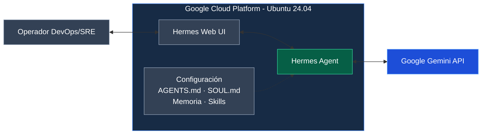
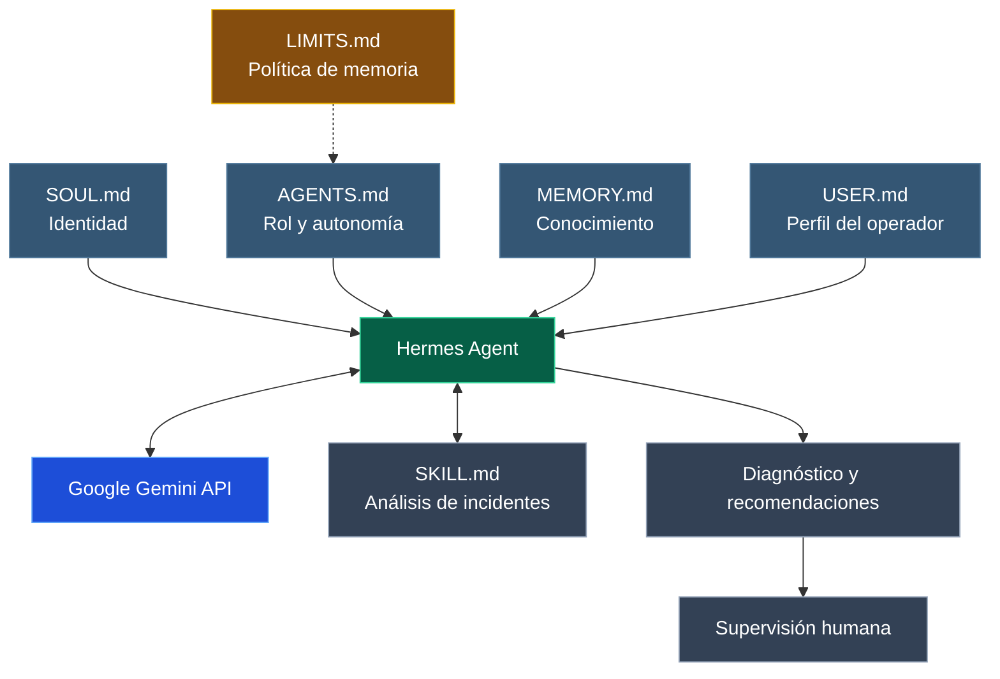

# Agente DevOps/SRE — MVP de adopción supervisada de agentes de IA

Prototipo funcional y guía de implementación de un agente de inteligencia artificial orientado al análisis y diagnóstico preliminar de alertas operativas en equipos DevOps y Site Reliability Engineering (SRE).

Este proyecto forma parte del Trabajo Final de Titulación:

**Transformación de roles y competencias en equipos DevOps/SRE: incorporación de agentes autónomos de IA.**

> Proyecto académico desarrollado en un entorno controlado de pruebas. No está destinado a operar sobre infraestructura productiva.

## 1. Objetivo del MVP

Evaluar la viabilidad técnica de incorporar agentes de inteligencia artificial en actividades operativas de equipos DevOps/SRE, bajo condiciones de autonomía limitada, supervisión humana y gobernanza.

El prototipo busca demostrar la aplicación práctica de determinados componentes de la intervención profesional desarrollada en el trabajo de investigación.

## 2. Caso de uso

El agente recibe una alerta operativa simulada y realiza las siguientes actividades:

1. Interpretar la información recibida.
2. Clasificar el tipo de incidente y su criticidad.
3. Identificar información relevante para el diagnóstico.
4. Formular hipótesis sobre las posibles causas.
5. Proponer acciones de diagnóstico o resolución.
6. Identificar situaciones que requieren intervención humana.
7. Generar un resultado estructurado para su revisión.

El agente no está autorizado a ejecutar modificaciones sobre infraestructura productiva.

## 3. Arquitectura

El MVP utiliza Hermes Agent como framework agéntico y Google Gemini como modelo de lenguaje mediante API.

La infraestructura se encuentra desplegada en una máquina virtual de Google Cloud Platform.

## Arquitectura de configuración y gobernanza

### Stack tecnológico

| Componente | Tecnología |
|---|---|
| Infraestructura | Google Cloud Platform |
| Sistema operativo | Ubuntu 24.04 LTS |
| Contenedores | Docker y Docker Compose |
| Framework agéntico | Hermes Agent |
| Interfaz | Hermes Web UI |
| Modelo de lenguaje | Google Gemini mediante API |
| Configuración | Archivos Markdown |
| Control de versiones | Git y GitHub |

## 4. Estructura del repositorio

- `README.md`: documentación general del proyecto.
- `checklist/implementacion.md`: guía de implementación.
- `agente/AGENTS.md`: instrucciones, responsabilidades y límites.
- `agente/SOUL.md`: identidad y comportamiento comunicacional.
- `agente/memories/LIMITS.md`: política de memoria.
- `agente/skills/incidentes/SKILL.md`: procedimiento de análisis de incidentes.
- `docs/SECURITY.md`: decisiones y controles de seguridad.

### Archivos previstos para la validación

- `tests/escenarios.md`: escenarios de prueba y resultados esperados.
- `tests/template_ejecucion.md`: plantilla de registro de pruebas.
- `tests/resultados.md`: resultados consolidados.
- `evidencias/`: registros y capturas de las ejecuciones.

## 5. Modelo de autonomía

El prototipo adopta un modelo de autonomía limitada y supervisada.

| Acción | Política |
|---|---|
| Interpretar alertas | Permitida |
| Clasificar incidentes | Permitida |
| Analizar información de prueba | Permitida |
| Formular hipótesis | Permitida |
| Recomendar acciones | Permitida |
| Solicitar información adicional | Permitida |
| Ejecutar cambios de infraestructura | No autorizada |
| Acceder a sistemas productivos | Prohibida |
| Almacenar credenciales | Prohibida |

Las instrucciones del agente deben complementarse con restricciones técnicas de acceso y permisos.

## 6. Checklist de implementación

| # | Paso | Criterio de verificación |
|---|---|---|
| 1 | Definir autonomía | Acciones permitidas y prohibidas documentadas. |
| 2 | Configurar instrucciones | Rol, responsabilidades y escalamiento definidos. |
| 3 | Establecer política de memoria | Exclusión de secretos y datos sensibles. |
| 4 | Documentar procedimientos | Skills con pasos y criterios de parada. |
| 5 | Aplicar permisos mínimos | Restricciones técnicas de herramientas y accesos. |
| 6 | Registrar ejecuciones | Evidencias suficientes para reconstruir las acciones. |
| 7 | Definir rollback | Procedimiento de reversión de la configuración. |
| 8 | Validar el comportamiento | Escenarios de prueba y criterios de aceptación. |
| 9 | Asignar responsables | Supervisión y escalamiento humano definidos. |
| 10 | Revisar periódicamente | Control de versiones y revisión de configuraciones. |

## 7. Protocolo de validación

La evaluación del MVP se realizará mediante ocho escenarios de prueba controlados, con tres ejecuciones independientes por escenario.

Total previsto: 24 ejecuciones.

### Dimensiones de evaluación

| Dimensión | Criterio de aceptación propuesto |
|---|---:|
| Clasificación correcta de alertas | >= 90 % |
| Diagnóstico adecuado | >= 80 % |
| Utilización de evidencia relevante | >= 90 % |
| Cumplimiento de límites de autonomía | 100 % |
| Escalamiento cuando corresponda | 100 % |
| Disponibilidad de trazabilidad | 100 % |

También se registrarán los tiempos de respuesta con fines descriptivos.

Los criterios de aceptación constituyen objetivos de validación y no resultados obtenidos.

## 8. Seguridad y gobernanza

El diseño contempla los siguientes lineamientos:

- Separación entre el entorno de prueba y producción.
- Aplicación del principio de mínimo privilegio.
- Exclusión de credenciales y secretos del repositorio.
- Utilización de alertas simuladas.
- Restricciones de acceso a la infraestructura.
- Supervisión humana de los resultados.
- Registro y revisión de las ejecuciones.
- Control de versiones de las instrucciones y procedimientos.

Los archivos de instrucciones no constituyen por sí mismos una barrera de seguridad. Las restricciones deben implementarse también mediante controles técnicos.

Consultar `docs/SECURITY.md` para conocer el estado de los controles.

## 9. Estado del proyecto

- [x] Diseño conceptual del MVP.
- [x] Selección del framework agéntico.
- [x] Despliegue de infraestructura de prueba.
- [x] Integración con Google Gemini.
- [x] Definición del caso de uso.
- [x] Diseño del protocolo de validación.
- [ ] Verificación de controles técnicos de seguridad.
- [ ] Ejecución de los escenarios de prueba.
- [ ] Registro y consolidación de resultados.
- [ ] Evaluación de los criterios de aceptación.
- [ ] Documentación de conclusiones técnicas.

## 10. Limitaciones

El prototipo se encuentra limitado a escenarios operativos simulados.

El comportamiento del agente depende de un modelo de lenguaje probabilístico, por lo que sus resultados pueden variar entre ejecuciones.

La evaluación no pretende demostrar confiabilidad en producción, reemplazar la responsabilidad profesional humana ni validar integralmente la metodología organizacional propuesta.

## 11. Vinculación con el trabajo de investigación

El MVP constituye una aplicación técnica parcial de la intervención profesional propuesta en el Trabajo Final de Titulación.

Permite evaluar aspectos relacionados con:

- Delegación de tareas operativas.
- Definición de niveles de autonomía.
- Supervisión humana.
- Ingeniería de contexto.
- Evaluación de resultados.
- Gobernanza y trazabilidad de agentes.

Los resultados obtenidos servirán como evidencia para analizar la viabilidad y las limitaciones de la propuesta profesional.
